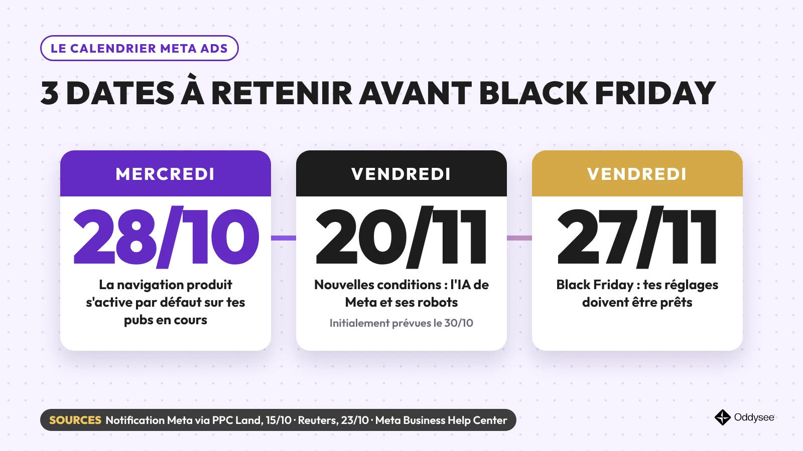
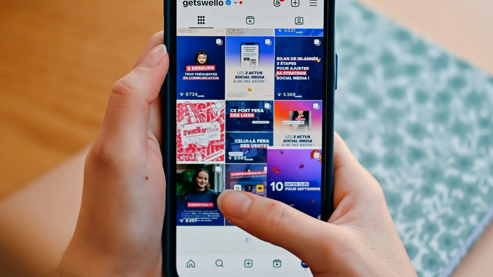
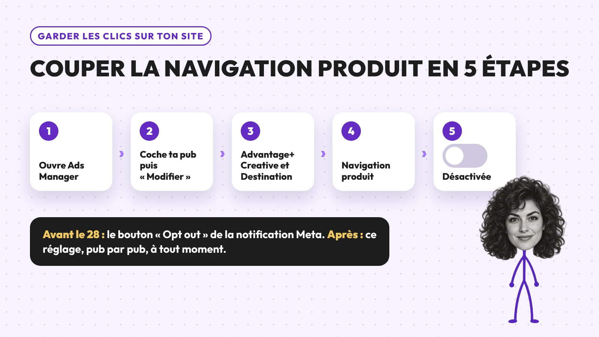
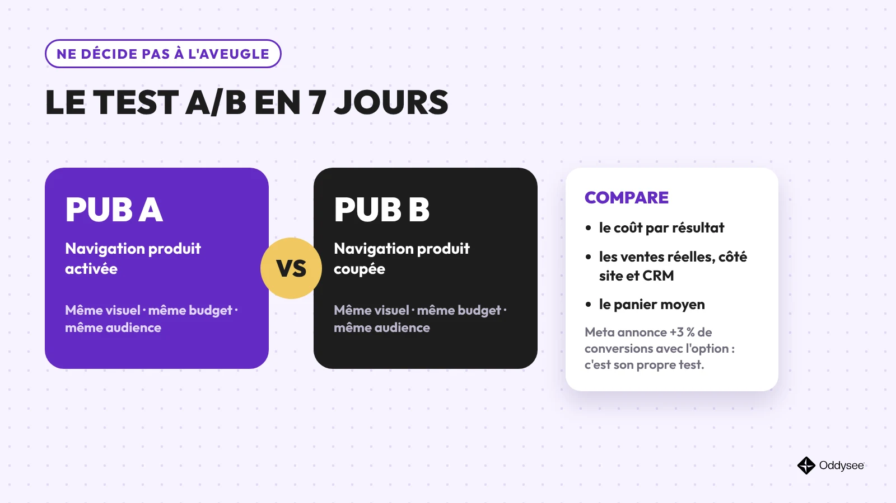
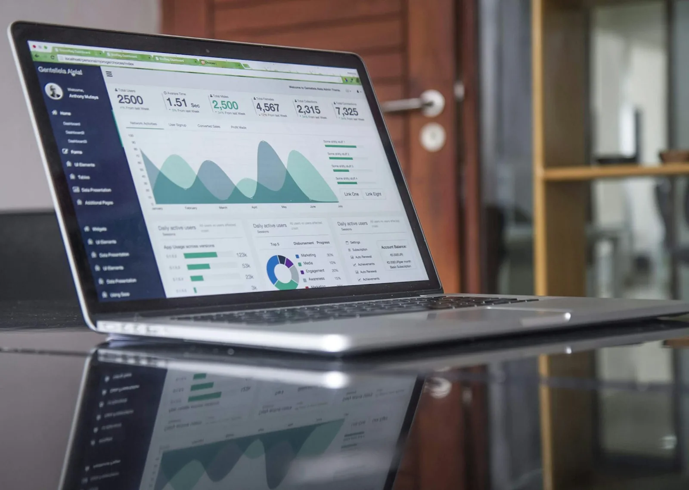
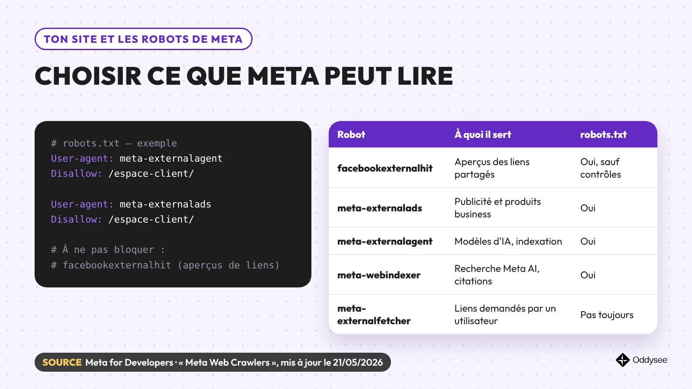
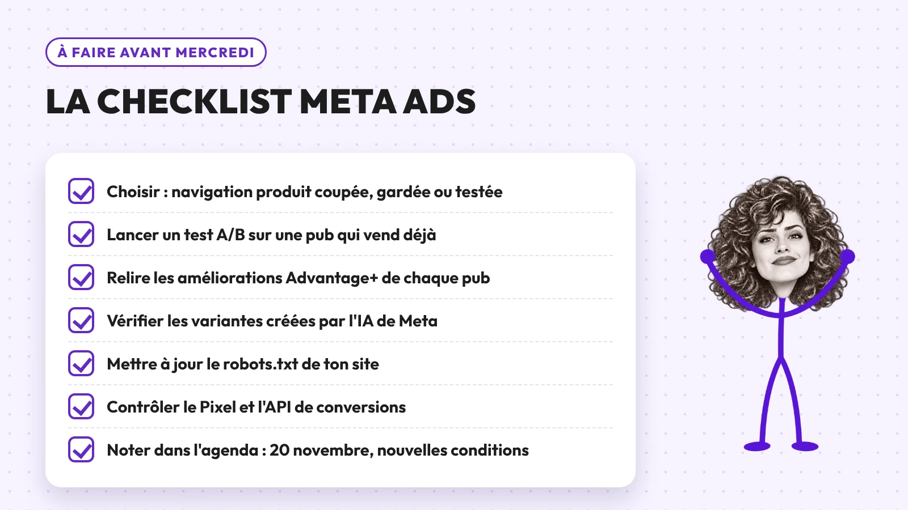

# Meta Ads : ce qui change le 28 octobre

<p class="meta-article">Publié le 25 octobre 2026 · Par Alvarez Mouko, fondateur d'Oddysee, certifié Meta Business Partner depuis 2019 · Lecture : 6 minutes</p>

<div class="essentiel" markdown="1">

**L'essentiel en 30 secondes**

- **Mercredi 28 octobre** : la « navigation produit » s'active par défaut sur vos publicités Facebook et Instagram déjà en ligne. Un clic peut ouvrir une page dans l'application… au lieu de votre site.
- **Vendredi 20 novembre** : les nouvelles conditions publicitaires de Meta entrent en vigueur. Elles étaient annoncées pour le 30 octobre.
- **Votre réflexe** : décider pub par pub, tester avant de trancher, relire ce que l'IA de Meta modifie.

</div>



Vous avez peut-être lu que « Meta change ses règles le 30 octobre ». Ce n'est plus vrai. Le 23 octobre, Meta a repoussé ses nouvelles conditions au 20 novembre ([Reuters](https://www.reuters.com/business/media-telecom/meta-delay-new-commercial-terms-criticised-by-publishers-advertisers-2026-10-23/)).

Une autre échéance, elle, ne bouge pas : mercredi 28 octobre.

Voici ce qui change, ce que vous risquez, et les 6 bonnes pratiques pour garder la main.

## 1. Le 28 octobre, la navigation produit s'active sur vos pubs

Meta a prévenu les annonceurs par une simple notification. Son titre : « Starting October 28, 2026, we'll add product browsing to your existing ads », soit « à partir du 28 octobre 2026, nous ajouterons la navigation produit à vos publicités existantes » ([texte rapporté par PPC Land](https://ppc.land/meta-will-turn-on-product-browsing-in-existing-ads-on-october-28/)).

Concrètement, quand quelqu'un touche votre publicité, il peut arriver sur une page dans Facebook ou Instagram. Elle affiche vos informations produit et des suggestions personnalisées. Votre site vient après… ou jamais.


<p class="credit">Photo : Swello / Unsplash</p>

**Ce que Meta met en avant** : +3 % de conversions en moyenne avec cette option. Le chiffre vient d'un test mené par Meta du 6 au 21 août 2026, sur environ 117 700 annonceurs (e-commerce, grande consommation, distribution).

**Ce que la notification ne dit pas** : quels formats, quels objectifs et quelles nouvelles publicités sont concernés. Ni où ces conversions sont comptées. PPC Land a [détaillé ces zones d'ombre](https://ppc.land/meta-will-turn-on-product-browsing-in-existing-ads-on-october-28/), et [The Keyword](https://www.thekeyword.co/news/meta-product-browsing-default) confirme le calendrier.

> Notre lecture : l'option n'est ni bonne ni mauvaise par principe. Elle se teste.

## 2. Couper la navigation produit (ou la garder) en 5 étapes

Deux possibilités, selon la date :

- **Avant le 28 octobre** : le bouton « Opt out » de la notification envoyée par Meta.
- **À tout moment** : le réglage de chaque publicité, dans les paramètres « Advantage+ Creative et Destination ».



1. Ouvrez Ads Manager.
2. Cochez la publicité, puis cliquez sur « Modifier ».
3. Ouvrez la section Advantage+ Creative et Destination.
4. Repérez « Navigation produit » (en anglais : *Product browsing*).
5. Désactivez-la, puis publiez la modification.

**Gardez-la** si votre site est lent sur mobile ou si vous vendez beaucoup de références via un catalogue. **Coupez-la** si votre page de vente fait le travail : offre claire, preuves, formulaire, suivi des conversions. Dans le doute, testez.

## 3. Ne décidez pas à l'aveugle : le test A/B en 7 jours



La méthode tient en quatre règles :

1. Dupliquez une publicité qui vend déjà.
2. Pub A : navigation produit activée. Pub B : désactivée.
3. Même visuel, même budget, même audience, pendant 7 jours minimum.
4. Comparez le coût par résultat… et vos ventes réelles, côté site et CRM.

Le dernier point compte. Quand la conversion se fait dans l'application, vos outils d'analyse ne la voient pas toujours. Ne jugez pas sur un seul tableau de bord.


<p class="credit">Photo : Carlos Muza / Unsplash</p>

## 4. 20 novembre : ce que l'IA de Meta change, vous en répondez

Les nouvelles conditions commerciales et publicitaires de Meta entrent en vigueur le 20 novembre 2026 ([Meta Business Help Center](https://www.facebook.com/business/help/2481113349080785)). Prévues pour le 30 octobre, elles ont été repoussées après des plaintes d'éditeurs et d'annonceurs auprès des autorités de la concurrence européennes et britanniques ([Reuters](https://www.reuters.com/business/media-telecom/meta-delay-new-commercial-terms-criticised-by-publishers-advertisers-2026-10-23/)).

Le point clé, relevé par Adweek et [PPC Land](https://ppc.land/meta-makes-advertisers-solely-responsible-for-its-ai-ad-edits-from-oct-30/) : une nouvelle section consacrée aux fonctionnalités d'IA. L'annonceur y devient « seul responsable » de ce que l'IA de Meta crée ou modifie dans ses publicités. Y compris pour les options activées par Meta. Les conditions préviennent que ces outils « peuvent faire des erreurs ».

Ce n'est pas théorique. En juin 2026, la marque REI a retiré une publicité Instagram : un outil d'IA activé à son insu avait déformé la photo d'un vélo ([PPC Land](https://ppc.land/reis-ai-bike-ad-fiasco-reveals-a-meta-auto-enrollment-setting-brands-missed/)).

**Ce qu'il faut faire :**

- Relisez les améliorations Advantage+ de chaque publicité. Certaines sont actives par défaut, d'autres ne se voient que dans l'aperçu avancé ([aide Meta](https://www.facebook.com/business/help/1082295769403815)).
- Gagnez du temps avec la modification groupée de ces améliorations ([aide Meta](https://www.facebook.com/business/help/691986150075749)).
- Pour les visuels créés ou retouchés avec l'IA générative, Meta prévoit une mention « Infos IA » sur la publicité ([aide Meta](https://www.facebook.com/business/help/1010479435004531)). Sachez quand elle s'applique à vous.

## 5. Votre site et les robots de Meta : le robots.txt

Les nouvelles conditions autorisent Meta à envoyer ses robots sur les sites liés à vos produits. Meta assure que le fichier robots.txt reste respecté ([Reuters](https://www.reuters.com/business/media-telecom/meta-delay-new-commercial-terms-criticised-by-publishers-advertisers-2026-10-23/)).



D'après la [documentation officielle de Meta](https://developers.facebook.com/docs/sharing/webmasters/web-crawlers/) :

- **facebookexternalhit** crée les aperçus de vos liens. Ne le bloquez pas : vos liens partagés perdraient leur image et leur titre.
- **meta-externalads** sert la publicité et les produits destinés aux entreprises.
- **meta-externalagent** sert à entraîner des modèles d'IA et à indexer des contenus.
- **meta-externalfetcher** suit des liens demandés par un utilisateur. Il peut ignorer le robots.txt.

Bloquez seulement les pages sensibles : espace client, documents internes, offres privées. Comptez jusqu'à 24 heures pour qu'un changement soit pris en compte.

```
User-agent: meta-externalagent
Disallow: /espace-client/

User-agent: meta-externalads
Disallow: /espace-client/
```

## 6. Mesurez juste : Pixel et API de conversions

Plus Meta automatise, plus vos propres données comptent.

- Installez le Pixel Meta **et** l'API de conversions. Elle envoie vos événements depuis votre serveur ou votre CRM ([documentation Meta](https://developers.facebook.com/documentation/ads-commerce/conversions-api)).
- Ajoutez des paramètres UTM à vos liens pour suivre chaque campagne dans vos statistiques.
- Gardez une page de vente rapide sur mobile : c'est elle qui transforme le clic en client. Besoin d'une base solide ? Voyez [notre offre de site en 7 jours](https://www.oddysee.fr/web).


<p class="credit">Photo : Austin Distel / Unsplash</p>

## La checklist avant mercredi



<ul class="checklist">
<li>Choisir : navigation produit coupée, gardée ou testée.</li>
<li>Lancer un test A/B sur une publicité qui vend déjà.</li>
<li>Relire les améliorations Advantage+ de chaque publicité.</li>
<li>Vérifier les variantes créées par l'IA de Meta.</li>
<li>Mettre à jour le robots.txt de votre site.</li>
<li>Contrôler le Pixel et l'API de conversions.</li>
<li>Noter dans l'agenda : 20 novembre, nouvelles conditions.</li>
</ul>

## Questions fréquentes

### La navigation produit fait-elle baisser les ventes ?

Pas forcément. Meta annonce +3 % de conversions en moyenne, sur son propre test. Tout dépend de votre site et de votre offre. Le test A/B vous donne la réponse, avec vos chiffres.

### Je n'ai pas reçu la notification. Suis-je concerné ?

La notification visait les « publicités existantes », sans préciser lesquelles. Le plus sûr : vérifier le réglage dans chacune de vos publicités actives. Deux minutes par publicité suffisent.

### Les nouvelles conditions s'appliquent-elles si je ne fais rien ?

Oui. Continuer à diffuser après le 20 novembre vaut acceptation : aucune signature n'est demandée. D'où l'intérêt de relire vos réglages avant cette date.

### Bloquer les robots de Meta peut-il nuire à mes publicités ?

Ne bloquez jamais facebookexternalhit : vos aperçus de liens disparaîtraient. Pour les autres robots, bloquez des dossiers précis plutôt que tout le site.

### Combien de temps doit durer un test ?

Sept jours minimum, avec le même budget des deux côtés. Attendez assez de conversions pour comparer : plusieurs dizaines par publicité, c'est mieux.

<div class="cta" markdown="1">

## Vous voulez qu'on vérifie vos réglages ?

Oddysee est certifiée Meta Business Partner. Nous passons vos campagnes en revue : navigation produit, améliorations IA, suivi des conversions.

<p><a class="bouton" href="https://www.oddysee.fr/contact?utm_source=blog&amp;utm_medium=article&amp;utm_campaign=meta-28-octobre">Je réserve mon audit Meta Ads offert</a></p>

<p class="petit">Vous préférez le lire hors ligne ? <a href="/guides/guide-meta-ads-oddysee.pdf">Je télécharge le guide en PDF</a></p>

</div>

## Sources

1. PPC Land, « Meta will turn on product browsing in existing ads on October 28 », 15 octobre 2026 — [ppc.land](https://ppc.land/meta-will-turn-on-product-browsing-in-existing-ads-on-october-28/)
2. The Keyword, « Meta Is Making Product Browsing the Default for Existing Ads » — [thekeyword.co](https://www.thekeyword.co/news/meta-product-browsing-default)
3. Reuters, « Meta to delay new commercial terms criticised by publishers, advertisers », 23 octobre 2026 — [reuters.com](https://www.reuters.com/business/media-telecom/meta-delay-new-commercial-terms-criticised-by-publishers-advertisers-2026-10-23/)
4. Meta Business Help Center, « Streamlining Meta's Commercial Terms, Product Catalog Terms, Self-Serve Ad Terms and Ad Creative Generative AI Terms » — [facebook.com](https://www.facebook.com/business/help/2481113349080785)
5. PPC Land, « Meta makes advertisers solely responsible for its AI ad edits », 22 octobre 2026 — [ppc.land](https://ppc.land/meta-makes-advertisers-solely-responsible-for-its-ai-ad-edits-from-oct-30/)
6. PPC Land, « REI's AI bike ad fiasco reveals a Meta auto-enrollment setting brands missed » — [ppc.land](https://ppc.land/reis-ai-bike-ad-fiasco-reveals-a-meta-auto-enrollment-setting-brands-missed/)
7. Meta Business Help Center, « Turn off Advantage+ creative enhancements in Meta Ads Manager » — [facebook.com](https://www.facebook.com/business/help/1082295769403815)
8. Meta Business Help Center, « Bulk edit Advantage+ creative enhancements » — [facebook.com](https://www.facebook.com/business/help/691986150075749)
9. Meta Business Help Center, « About AI info on ads created or edited with generative AI tools » — [facebook.com](https://www.facebook.com/business/help/1010479435004531)
10. Meta for Developers, « Meta Web Crawlers », mis à jour le 21 mai 2026 — [developers.facebook.com](https://developers.facebook.com/docs/sharing/webmasters/web-crawlers/)
11. Meta for Developers, « Conversions API » — [developers.facebook.com](https://developers.facebook.com/documentation/ads-commerce/conversions-api)

Photos : Swello, Carlos Muza et Austin Distel sur [Unsplash](https://unsplash.com/license) (licence Unsplash). Visuels : Oddysee.
